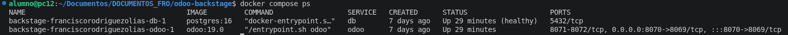

# BackStage Rent · Módulo de alquileres para Odoo

**Alumno/a:** *Francisco Rodríguez olías* · SGE · 2.º DAM · IES El Majuelo

## Apartado 0 · Mi instalación de Odoo

> Sustituye todo lo que está en *cursiva* y borra las líneas que empiezan por `>`. Escribe con tus palabras.

### 1. Mi equipo, el sistema operativo y la base de datos

| | |
|---|---|
| Sistema operativo de mi equipo | *Ubuntu del aula* |
| Sistema operativo dentro del contenedor de Odoo | *Ubuntu 24.04.5 LTS* |
| Gestor de base de datos y versión | *psql (PostgreSQL) 16.16 (Debian 16.16-1.pgdg13+1)* |
| Versión de Odoo y puerto | *odoo:19.0 ports:"8070:8069"* |

*Porque así nos quitamos de configurar las dependencias, como por ejemplo python, que es lo que usamos y no tenemos que configurar manualmente nada.*

### 2. Arquitectura

> Completa el esquema con los datos de tu `docker-compose.yml`.

```text
Navegador ──puerto _8070:8069_──▶ contenedor _odoo_ ────────────────▶ contenedor _services_
                                   │                                         │
                                volumen - odoo_web_data:/var/lib/odoo        |
                                        - ./addons:/mnt/extra-addons      volumen - odoo_db_data:/var/lib/postgresql/data
```

*Cliente: Hace que el usuario puede interactuar con el sistema.  
Servidor de Aplicaciones: La lógica del sistema.  
Capa de datos: Organiza la información con tablas.*

### 3. Comprobación y copia de seguridad



*Me hace una lista de los contenedores que tengo en docker, pudiendo ver así las principales características de cada uno de ellos y si están activos o no.*

*Copia de Seguridad:  
Nombre: backstage_2026-11-25_14-46-07.zip  
Tamaño: 2,0 MB (2047765 bytes)  
Guardado en: /home/alumno/Documentos/DOCUMENTOS_FRO*

### 4. Licencia

*Odoo Community es de código abierto y gratuita mientras que Odoo Enterprise es de pago e incluye muchas funciones como por ejemplo, el soporte oficial. La licencia LGPL-3 permite usar, modificar y distribuir los módulos libremente pero tendrás que liberar el código fuente siempre que lo distribuyas.*

### 5. Incidencias

| Issue | Problema | Causa | Solución |
|---|---|---|---|
| *[#1](enlace a la issue)* | | | |
